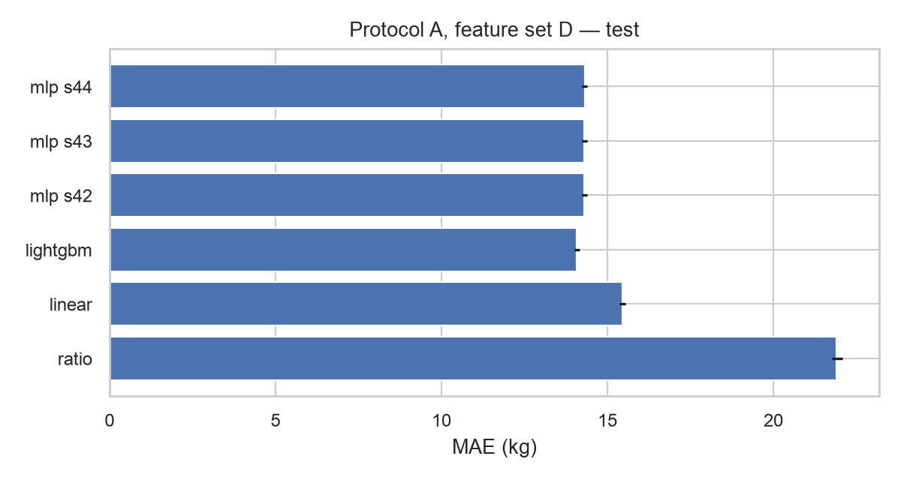
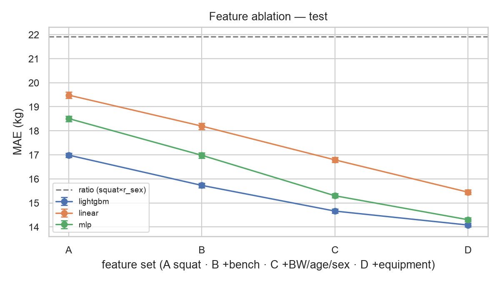

# Predicting Competition Deadlift from Squat, Bench, and Lifter Characteristics

CSC 5887 final project — Dakshesh Pasala, Kevin Beltran, Dhanvi Ganti.

**Scope.** Same-meet supervised regression: predict a lifter's best successful deadlift at a meet
(`Best3DeadliftKg`) from that meet's squat and bench and the lifter's recorded characteristics.
Predictions are reference values for comparing recorded performance among similar lifters. They are not
forecasts of future strength, estimates of a physiological maximum, attempt recommendations, or diagnoses
of weakness, and residuals are not interpreted as undertraining, injury risk, or causal effects.

All numbers below are measured on the full OpenPowerlifting snapshot described in §1, on **test** partitions,
after every configuration was frozen. Full tables: `reports/full/results_test.md` (test),
`reports/full/results_val.md` (validation), `reports/full/data_audit.md` (data). MAE is in kg; brackets are
95% confidence intervals from 200 bootstrap resamples of **whole lifters**. "Paired Δ" is the MAE difference
between two models on identical rows (negative = first model better).

---

## 1. Data

| Item | Value |
|---|---|
| Source | OpenPowerlifting bulk CSV, `openpowerlifting-2026-10-24-0fc10dd9.zip`, sha256 `26be6b73…afe7`, retrieved 2026-10-29 |
| Raw rows | 4,054,260 (the download page lists 4,054,261; it most likely counts the header line) |
| Full-power (SBD) rows | 2,927,873 |
| Removed: missing/zero/failed best squat, bench, deadlift | 131,602 / 61,403 / 30,514 |
| Removed: exact duplicate rows | 1,709 |
| Removed: repeated listings (same Name, date, equipment, and all three lifts) | 107,885 — 107,440 are one entry listed in several divisions; 445 are cross-listed under another meet |
| **Cleaned rows / lifters** | **2,594,760 rows, 788,075 lifters**, meets 1964-09-05 to 2026-10-18 |
| Missing age / bodyweight | 42.6% / 0.5% — rows kept; median-imputed with a missing indicator, fitted on training data only |
| Extreme values flagged but kept | 238 deadlifts > 400 kg; 1,597 deadlift/squat ratios > 3; 1,523 < 0.4 |
| Rows with an earlier meet (history-eligible) | 1,804,454 (69.5%) from 430,939 lifters |

**Identity.** OpenPowerlifting marks different lifters who share a name with a `#n` suffix in `Name`. The full
Name is used as the identity (hashed to a pseudonymous key) and nothing is fuzzy-merged. The audit found 31,260
suffixed lifters, 1,312 identities recorded under more than one Sex, 16,094 whose implied birth year varies by
more than 2 years, and 3,129 lifter-days with two different meet records. These are reported, not corrected
(§6).

**Splits** (frozen in `data/processed/full/manifest.parquet`, split ID `9eacfcc77688`):

- **A — unseen lifters.** 70/15/15 by hashed identity, seed 42. The partitions share no lifters, which is asserted
  in code. Their covariates match within about 1 percentage point (`reports/full/balance_protocol_A.csv`).
- **B — later meets.** Train before 2023-01-01, validation to 2024-10-31, test from 2024-11-01. The boundaries are
  the 70% and 85% date quantiles. Lifters recur across periods, so this measures future meets, not unseen
  people. Later periods have more women and more Raw lifting (`balance_protocol_B.csv`).
- **C — transfer.** One group is held out of training and tuning; models are trained on A-train and tested on
  the A-test lifters, split into inside and outside the held-out group. Groups were picked by row count only:
  each equipment class with at least 20,000 rows except the largest (Raw) — Single-ply, Unlimited, Wraps,
  Multi-ply — and the three largest federations, THSPA, USAPL, and THSWPA. THSPA and THSWPA are the Texas
  high-school federations.

## 2. Methods

**Inputs** are restricted to an explicit allowlist: squat, bench, bodyweight, age, sex, equipment, and federation
(federation only in extension E). History features add the previous meet's squat, bench, deadlift, days since that
meet, and number of earlier meets, taken strictly from earlier dates. Same-day rows never see each other because
their order is unknown. Total, Dots/Wilks-style scores, placing, attempts, weight class, names, and dates are
excluded, and tests check this.

**Models.**

| Model | Details |
|---|---|
| Ratio | deadlift = r_sex × squat, least squares through the origin; pooled r for unseen sex |
| Linear | Standardized numerics with missing indicators and one-hot categoricals; ridge strength chosen on validation from {0, 1, 10, 100} |
| LightGBM | L2 objective, 4-configuration grid, early stopping on validation L1 |
| MLP | [128, 64] ReLU, dropout 0.1, Adam, L1 loss (matches the MAE metric), standardized target, early stopping on validation MAE; 3 seeds at feature set D |

Every model's preprocessing was fitted on its own training partition, and unseen categories map to an
explicit "unknown" code.

**Pre-registered capacity check** (validation only, before any test scoring): two larger MLPs ([256, 128] and
[512, 256, 128]) and a larger LightGBM (511 leaves, learning rate 0.03, up to 8,000 trees). The rule was fixed
before seeing results: a larger model replaces the base model only if it gains at least 0.2 kg on validation.

## 3. Results

### RQ1 — How accurately can deadlift be predicted? (protocol A, 386,613 test rows, 118,000 unseen lifters)

| Model (feature set D) | MAE | Lifter-avg MAE | MAPE | R² |
|---|---|---|---|---|
| Ratio (squat × r_sex) | 21.91 [21.76, 22.09] | 21.63 | 12.3% | 0.769 |
| Linear | 15.45 [15.35, 15.55] | 15.34 | 9.2% | 0.883 |
| **LightGBM** | **14.08 [14.01, 14.16]** | 14.03 | **8.3%** | **0.903** |
| MLP (3 seeds) | 14.30 / 14.30 / 14.31 | 14.23 | 8.3% | 0.900 |

The mean deadlift is 185.5 kg. On validation, LightGBM's median absolute error is 11 kg, and 76% of
predictions fall within 20 kg. LightGBM beats the MLP by 0.22 kg (paired Δ, CI [0.20, 0.24]), and the gap is the
same across all 3 seeds. Larger models did not help: the best larger variant changed test MAE by at most
0.035 kg, and none met the 0.2 kg rule on validation, so the base models stayed final.



### RQ2 — Which feature groups help? (same 386,613 rows at every stage)

| Stage | Linear | LightGBM | MLP | LightGBM paired Δ vs previous stage |
|---|---|---|---|---|
| A: squat | 19.48 | 16.99 | 18.51 | — |
| B: + bench | 18.19 | 15.73 | 16.98 | −1.26 [−1.30, −1.21] |
| C: + bodyweight, age, sex | 16.79 | 14.66 | 15.30 | −1.07 [−1.13, −1.02] |
| D: + equipment | 15.45 | 14.08 | 14.30 | −0.58 [−0.62, −0.55] |
| E: + federation (extension) | 14.86 | 13.83 | 13.83 | −0.25 [−0.27, −0.23] |

Every step helps for every model, and every confidence interval excludes zero. The gains get smaller as more is
added. LightGBM using squat alone (16.99) already beats the squat-ratio baseline by about 5 kg, so the
relationship is not a fixed ratio. These gains measure predictive contribution, not causal or biological
importance.



### RQ3 — Do earlier meets help? (same 268,289 history-eligible test rows, 64,764 lifters)

| Model | MAE | MAPE | R² |
|---|---|---|---|
| Repeat last deadlift | 13.44 [13.33, 13.57] | 7.9% | 0.860 |
| LightGBM D, no history | 14.20 | 8.0% | 0.903 |
| Linear D + history | 9.86 | 5.8% | 0.941 |
| **LightGBM D + history** | **8.73 [8.69, 8.79]** | **5.1%** | **0.954** |
| **MLP D + history** | **8.71 [8.66, 8.76]** | **5.1%** | **0.953** |

History reduces error by 5.5 kg for LightGBM (paired Δ −5.48 [−5.58, −5.39]). It also beats simply repeating the
previous deadlift by 4.7 kg (Δ −4.71 [−4.79, −4.62]), so the model adds more than persistence. With history, the
MLP essentially ties LightGBM. The test lifters' own earlier meets are used as input context only; none of their
rows were used for fitting or preprocessing. The 118,324 test rows without history (each lifter's first meet)
are scored separately: LightGBM gets 13.80 kg there, and no past performance is invented for them.

#### Follow-up: career-summary history (post-hoc)

This experiment was designed **after** the results above were reported. Its settings were fixed in advance,
tuned on validation only, and scored on test once. It adds, from strictly earlier meets:

- best previous squat, bench, and deadlift;
- the career average of deadlift ÷ squat and of deadlift ÷ (squat + bench);
- the deadlift from two meets ago;
- days since the first meet;
- whether the previous meet used the same equipment.

| Same 268,289 protocol-A test rows | MAE | MAPE | R² |
|---|---|---|---|
| LightGBM, previous meet only | 8.73 | 5.1% | 0.954 |
| **LightGBM, + career summaries** | **8.41 [8.37, 8.47]** | 5.0% | 0.957 |
| **MLP, + career summaries** | **8.38 [8.34, 8.44]** | 5.0% | 0.956 |

- **Gain:** paired Δ −0.32 kg [−0.34, −0.30] for LightGBM and −0.33 kg for the MLP.
- **Typical error:** the median absolute error is 6.0 kg; 71% of predictions fall within 10 kg and 92% within 20 kg.
- **Later meets:** on protocol B, history-eligible rows go from 8.47 to 8.17 kg (Δ −0.31 [−0.32, −0.29]).
- **Verdict:** the gain is consistent and real, but smaller than the 0.5–1.5 kg we expected. Most of the useful
  history is already captured by the previous meet alone.

#### Follow-up: LightGBM + MLP ensemble (post-hoc)

prediction = w × LightGBM + (1 − w) × MLP, with w chosen by validation MAE from {0, 0.25, 0.5, 0.75, 1} and
test scored once.

| Test rows | w (from validation) | LightGBM | MLP | Ensemble | Δ vs best single model |
|---|---|---|---|---|---|
| A, feature set D (386,613) | 0.75 | 14.08 | 14.30 | 14.08 | +0.001 [−0.004, 0.006] vs LightGBM |
| A, + career history (268,289) | 0.5 | 8.41 | 8.38 | **8.32** | −0.062 [−0.070, −0.056] vs MLP |
| B, feature set D (402,128) | 0.5 | 14.04 | 14.00 | 13.97 | −0.032 [−0.038, −0.025] vs MLP |

Averaging gives no gain without history and less than 0.1 kg with it. The two model types make nearly the same
errors, which fits the earlier conclusion that the inputs, not the model, are the limit. The best test result
for returning lifters is the career-history ensemble, at **8.32 kg**.

#### Follow-up: prediction ranges (post-hoc)

Two LightGBM quantile models predict the 10th and 90th percentiles, which together give a nominal 80% range.
They reuse the protocol-A tree settings and early-stop on validation pinball loss. A conformal correction (CQR)
is then estimated on **validation rows only** and applied unchanged to test.

| Test rows | Correction | Coverage, raw | Coverage, calibrated | Median width |
|---|---|---|---|---|
| A, feature set D (386,613) | +0.30 kg | 79.4% | **80.0%** | 45 kg |
| A, + career history (268,289) | +0.56 kg | 78.2% | **80.3%** | 24 kg |

Misses are balanced: about 10% of rows fall below the range and about 10% above. Coverage holds within about
1.5 points across Sex, bodyweight bins, and equipment. The exceptions are Mx (71%, 14 rows) and Multi-ply with
history (77%). Ranges widen with lift size: about 33 kg for women versus 50 kg for men without history.

A typical range is about ±22 kg around the prediction, or about ±12 kg with history. Ranges don't make point
predictions more accurate. They state honestly how uncertain a single same-meet reference value is. Validation
rows from one lifter are correlated, and the quantile models also early-stopped on validation, so the coverage
guarantee is approximate. Test coverage is the independent check, and it matched.

#### Follow-up: expanded inputs (post-hoc, team-approved widening of the allowlist)

The original allowlist was widened. Deadlift attempts, totals, scores, placings, and anything else derived from
the result remain forbidden. The new inputs:

- **Squat and bench attempts** (deadlift attempts never used): opener ÷ best, third attempt ÷ best (above 1 when a
  heavier third was missed), and number of good lifts. Reported for 45.6% of rows; missing elsewhere.
- **Context:** age filled from AgeClass/BirthYearClass (missing age falls from 42.6% to 30.1%), drug-tested status,
  home country, parent federation, meet year, and federation.
- **Any-event deadlift history:** successful deadlifts from earlier deadlift-only, push-pull, and squat-deadlift
  entries, plus full-power entries that failed another lift. That adds 233,834 non-full-power deadlift meets.
  Strictly earlier dates only; tests check same-day exclusion, order independence, and a brute-force recomputation.

Test MAE, identical rows within each block:

| Rows | Before | After | Paired Δ |
|---|---|---|---|
| All 386,613 test rows, LightGBM, same-meet inputs only: D → X_all (attempts + context) | 14.08 | 13.68 | −0.40 [−0.43, −0.38] |
| … attempts alone | 14.08 | 14.02 | −0.06 [−0.07, −0.05] |
| … context alone | 14.08 | 13.71 | −0.37 [−0.40, −0.35] |
| **Full-power first-timers** (118,324): D LightGBM → X_all + any-event history, ensemble | 13.80 | **13.04** | −0.76 [−0.79, −0.73] |
| First-timers with an earlier deadlift-only or push-pull meet (4,400) | 15.36 | **10.39** | −4.97 [−5.29, −4.64] |
| Returning lifters (268,289): career-history ensemble → + all new inputs, ensemble | 8.32 | **8.25** | −0.07 [−0.08, −0.06] |
| Later meets (B), returning lifters, LightGBM | 8.17 | 8.11 | −0.06 [−0.07, −0.05] |
| **All test lifters, best system** (first-timer model + returning-lifter model) | 10.00 | **9.71** | −0.28 [−0.29, −0.27] |

- **First-timers gain the most.** Their error falls by 0.76 kg overall, and by about 5 kg for the 3.7% who have a
  deadlift from another kind of meet. Only those few gain much, because most full-power first-timers have no
  earlier deadlift anywhere.
- **Returning lifters barely change.** The previous meet already carries most of the signal.
- **One model for everyone loses to two specialists.** A single model across all rows reaches 10.19 kg, worse
  than routing each lifter to its specialist (9.71). The "14.1 → 10.2" all-rows comparison mainly re-measures the
  value of history.
- **Attempts help least.** Squat and bench attempt details are the weakest new group (−0.06 kg), partly because
  more than half of federations don't report attempts.
- **Context helps more.** It is worth about 0.37 kg; federation alone accounts for about 0.25 kg of that (see the E
  extension).

#### Follow-up: LightGBM loss and target (post-hoc)

The base LightGBM uses squared error, while the primary metric is MAE. For the two expanded-input specialists, four
variants were trained on validation, reusing the same tree settings:

- L1 loss
- Huber loss (δ = 10 kg)
- predicting deadlift ÷ squat with squared error
- predicting deadlift ÷ squat with L1

The ratio fits weight each row by squat (L1) or squat² (L2), so the loss stays on the kg scale. The winner per
specialist was the lowest validation MAE, base included.

| Test MAE (kg), identical rows | Base (L2) | L1 | **Huber** | Ratio, L2 | Ratio, L1 |
|---|---|---|---|---|---|
| All-lifter model (386,613) | 10.29 | 10.24 | **10.20** | 10.31 | 10.29 |
| Returning-lifter model (268,289) | 8.36 | 8.32 | **8.25** | 8.47 | 8.40 |

- **Huber wins for both** on validation and on test. Paired Δ versus base is −0.09 [−0.10, −0.08] and
  −0.11 [−0.12, −0.10]. It limits the pull of extreme or mis-entered rows without discarding them.
- **The ratio target doesn't help.** It is slightly worse with history (+0.04 to +0.11 kg): trees already model
  the deadlift-to-squat relationship, and the ratio form amplifies noise for small squats.

**Best system (routed: first-timer model, or returning-lifter model when an earlier full-power meet exists):**

| Test rows | Original specialists | + expanded inputs | **+ Huber** |
|---|---|---|---|
| All lifters (386,613 / 118,000) | 10.00 | 9.71 | **9.68** [9.64, 9.73] |
| First-timers (118,324) | 13.80 | 13.04 | **13.03** |
| Returning lifters (268,289) | 8.32 | 8.25 | **8.21** |

Against the original specialists, the paired Δ for all lifters is −0.31 kg [−0.32, −0.30]. The best system's
median absolute error is 6.9 kg; 65% of predictions fall within 10 kg and 89% within 20 kg.

### RQ4 — Later meets and unseen groups

**Later meets (protocol B, 402,128 test rows from 2024-11 onward).** LightGBM gets 14.04 kg and the MLP 14.00 kg,
about the same as for unseen lifters. With history, LightGBM gets 8.47 kg against 12.54 kg for repeating the last
deadlift. So performance holds up about 2 years past the training period.

**Held-out equipment (protocol C).** Test MAE on the held-out group, versus the same model on in-distribution test
lifters:

| Held out | Rows / lifters | Linear, with equipment | Linear, without | LightGBM, with equipment | LightGBM, without | MLP, with equipment | Same LightGBM, in-dist |
|---|---|---|---|---|---|---|---|
| Single-ply | 147,373 / 44,780 | 15.86 | 17.33 | 16.00 | **15.31** | 24.09 | 14.17 |
| Unlimited | 40,208 / 9,449 | **62.82** | 15.81 | 15.06 | **13.14** | 31.38 | 14.39 |
| Wraps | 31,414 / 15,236 | **83.87** | 17.44 | 22.22 | **17.00** | 18.72 | 13.92 |
| Multi-ply | 7,369 / 3,006 | **116.70** | 34.68 | **22.62** | 25.72 | 38.60 | 13.95 |

**Held-out federation:**

| Held out | Rows / lifters | Linear, with federation | Linear, without | LightGBM, with federation | LightGBM, without | Same LightGBM, in-dist |
|---|---|---|---|---|---|---|
| THSPA (high-school boys) | 69,477 / 16,983 | 18.64 | **17.88** | 19.97 | 18.42 | 13.99 |
| USAPL | 43,006 / 17,917 | 15.36 | 15.43 | 14.34 | 14.38 | 13.79 |
| THSWPA (high-school girls) | 42,326 / 8,254 | 10.59 | 10.89 | 12.70 | 12.28 | 14.40 |

- **USAPL transfers well:** 14.3 kg versus 13.8 kg in-distribution.
- **Texas high-school federations transfer worse.** Both are very different populations: THSWPA is entirely
  female, with mean squat 108 kg versus 179 kg in-distribution, and 94% missing age. A lower MAE there (10.6 kg)
  comes with a lower R² (0.69), because their deadlifts vary much less.
- **Multi-ply is the clearest population shift.** Mean squat is 261 kg but mean deadlift only 235 kg, because
  multi-ply suits raise squats far more than deadlifts. The squat ratio fails badly (51.6 kg).
- These gaps reflect population differences as well as equipment rules, and they are not causal effects of
  equipment or federation.

**Failure: the held-out category becomes "unknown," and linear models break.** When the held-out category is
missing from training, the with-field linear model is off by 63–117 kg. The unknown code has no coefficient and
all equipment dummies are zero, a combination that never occurs in training, so the prediction loses the
equipment baseline entirely. The MLP degrades the same way, less severely (24–39 kg). This is exactly why
the sensitivity runs without the field exist, and the correct takeaway is not to feed an unsupported category to
a model trained without it. Dropping the field fixes linear (15.8–34.7 kg). LightGBM is much more robust but
still usually better without the field (3 of 4 equipment groups; THSPA/THSWPA).

## 4. Hypotheses that did not hold

- **"A deeper or wider network will beat gradient boosting."** It did not. At the same feature set, LightGBM beat
  every MLP size by about 0.2 kg; with history they tie. About 25× more MLP parameters changed MAE by about
  0.01–0.03 kg.
- **"10× more data will substantially improve accuracy."** Going from the 10% lifter subset to the full data
  improved LightGBM validation MAE by only 0.2 kg (14.32 to 14.10 kg). The remaining error mostly reflects
  information these inputs do not contain.
- **"Knowing the category always helps transfer."** It did not for unseen categories (§3, RQ4).
- **"Career-level history will cut error by another 0.5–1.5 kg."** It cut error by 0.32 kg. That's real, but the
  previous meet already carries most of the signal.
- **"Averaging LightGBM and the MLP will gain 0.1–0.3 kg."** It gained 0–0.09 kg; the two models' errors are highly correlated.
- **"Squat/bench attempt details will help first-timers."** Only marginally (−0.06 kg); age-class fill and context helped more.
- **"Predicting the deadlift-to-squat ratio will help."** It did not (+0.0 to +0.1 kg); the Huber loss on kg did help slightly (−0.1 kg).
- **"Federation is a strong signal."** It gives the smallest stage gain, −0.25 kg with LightGBM, and none for
  USAPL transfer.

## 5. Subgroups (LightGBM D, protocol A test)

| Group | Rows | MAE | MAPE |
|---|---|---|---|
| Female | 119,451 | 10.38 | 8.8% |
| Male | 267,148 | 15.73 | 8.0% |
| Mx | 14 (sparse) | 15.83 | 11.7% |
| BW < 60 kg | 64,134 | 10.19 | 8.9% |
| BW 75–90 kg | 94,517 | 14.39 | 8.1% |
| BW ≥ 120 kg | 25,559 | 19.07 | 8.9% |
| BW missing | 1,983 | 19.46 | 9.7% |
| Multi-ply | 7,369 | 20.43 | 9.9% |

Absolute error grows with lift size, but relative error is fairly even (8–9%). Mx (14 rows) is too sparse to
interpret. Bodyweight bins were fixed in the config before evaluation. Figure: `full/figures/subgroups_test.png`;
residuals vs actual: `full/figures/actual_vs_pred_test.png`. Residuals show the usual regression toward the mean:
the heaviest deadlifts are under-predicted and the lightest over-predicted. This is a property of conditional-mean
prediction, not evidence about any lifter.

## 6. Limitations

- **Identity.** Same-name lifters without a `#n` suffix are assumed to be one person, and one person entered under
  two spellings counts as two. Either error can put one athlete in both train and test. About 2% of lifters have
  inconsistent implied birth years.
- **Repeated listings.** Collapsing them requires identical Name, date, equipment, and all three lifts. Near
  duplicates, such as rounding differences between federations, remain.
- **Equipment is a category, not what was worn** (per the OpenPowerlifting docs). Wraps meets allow, but don't
  require, knee wraps.
- **Age** is 43% missing, and some ages are approximate (n + 0.5).
- **Federation-level grouping** in protocol C is confounded with country, era, age group, and drug-testing policy.
- **Bootstrap CIs** resample lifters but not meets, so meet-level correlation is not captured.
- **Tuning budget.** Results reflect a modest, fixed tuning budget, not exhaustive search.
- **Population.** The data cover competitive powerlifters who recorded a successful deadlift; results do not
  extend beyond that population.

## 7. Related work (metadata verified via Crossref / the source PDF; contents only as stated)

- L. Ferrari, G. Bochicchio, A. Bottari, F. Lucertini, S. Pogliaghi, "Predicting Future Performance in
  Powerlifting: A Machine Learning Approach," *Sports Medicine – Open* 11:112 (2025),
  doi:10.1186/s40798-025-00903-z. Its abstract describes a machine-learning linear regression predicting future
  classic-powerlifting single-lift and total performance from sex, age, weight, initial strength, and competition
  history, on 54,064 observations from 8,907 lifters. That is future-performance forecasting; this project is
  same-meet cross-lift prediction.
- J. Medina-Romero, A. M. Mora, J. F. Valenzuela-Valdés, P. Á. Castillo, "Applying Data Mining and Machine Learning
  Techniques to Predict Powerlifting Results," *Engineering Proceedings* 39(1):20, ITISE 2023,
  doi:10.3390/engproc2023039020. Its contents were not accessible for verification.
- "Predicting a Successful Attempt in Raw Powerlifting. A Nonlinear Mixed Logistic Regression Analysis" (DCU,
  2025; https://doras.dcu.ie/31743/). This models attempt success, a different target. The author list could not
  be extracted and is cited from the repository URL ("Darragh et al.").
- Y. Romano, E. Patterson, E. Candès, "Conformalized Quantile Regression," NeurIPS 2019 (the calibration method used for ranges).
- G. Ke et al., "LightGBM: A Highly Efficient Gradient Boosting Decision Tree," NeurIPS 2017 (the library used here).

No novelty is claimed beyond the combination reported: same-meet prediction with controlled ablations, past-only
history on identical rows, and chronological and group-transfer tests.

## 8. Reproducibility

```bash
python3.13 -m venv .venv && .venv/bin/pip install -r requirements.lock && .venv/bin/pip install -e ".[dev]" --no-deps
.venv/bin/pytest -q                                    # 51 tests
.venv/bin/deadlift download                            # registers the snapshot (reuses data/raw if present)
.venv/bin/deadlift prepare   --config configs/default.yaml
.venv/bin/deadlift train     --config configs/default.yaml   # 73 runs + 6 capacity + 3 career-history + 4 quantile + 12 expanded-input + 8 objective runs
.venv/bin/deadlift ensemble  --config configs/default.yaml   # 7 LightGBM+MLP ensembles + 3 routed systems
.venv/bin/deadlift evaluate  --config configs/default.yaml --final
.venv/bin/deadlift summarize --config configs/default.yaml --final
```

Every run directory (`artifacts/full/runs/<run_id>/`) holds the model with its fitted preprocessor, per-row
predictions with row and lifter IDs, and `meta.json`. The metadata records the config and its hash, dataset
checksum, split ID, seed, package versions, tuning history, selected settings, validation metrics, and runtime.
Measured runtimes on an 8-core Apple-silicon laptop:

| Step | Runtime |
|---|---|
| Prepare | about 1 minute |
| A LightGBM grid | 15–80 s |
| One MLP | 20–270 s |

Running LightGBM and PyTorch in the same process deadlocks or crashes, because each package bundles its own
OpenMP runtime, so training runs them in separate processes.

**Run vs planned.** Everything listed above was run on the full snapshot. Not done: hyperparameter search beyond
the stated grids, MLP seeds beyond 3 (feature set D only), and cross-validated or meet-level bootstrap intervals.
